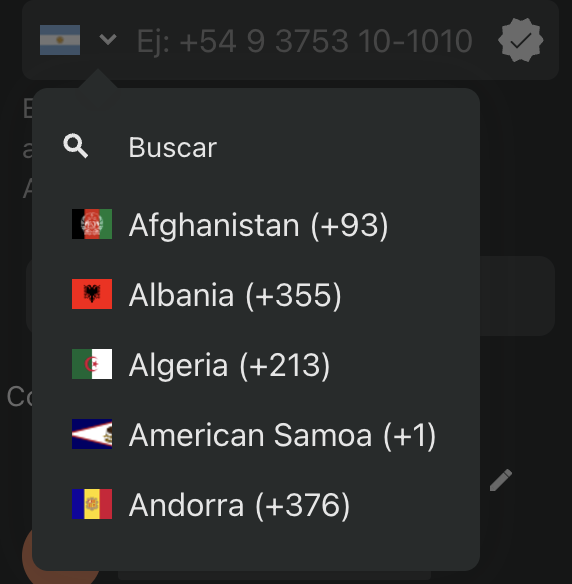

# react-native-country-iso-selector

`react-native-country-iso-selector` is a React Native component library that provides a country selector with ISO codes and flags.

## Installation

To install the library, use npm or yarn:

```bash
npm install react-native-country-iso-selector
```

or

```bash
yarn add react-native-country-iso-selector
```

## ScreenShots

Example using in popover component




## Usage

Here is an example of how to use the `CountrySelector` and `SelectedCountryDisplay` components:

```tsx
import React, { useState } from 'react';
import { View } from 'react-native';
import { CountrySelector, SelectedCountryDisplay } from 'react-native-country-iso-selector';

const App = () => {
    const [selectedCountry, setSelectedCountry] = useState(null);

    return (
        <View>
            <CountrySelector
                setCountry={setSelectedCountry}
                placeholder="Select a country"
                leftComponent={<YourCustomComponent />}
            />
            <SelectedCountryDisplay
                country={selectedCountry}
                iconSize={20}
                iconColor="blue"
            />
        </View>
    );
};

export default App;
```

## Props

### CountrySelector

- `setCountry`: Function to set the selected country.
- `placeholder`: Placeholder text for the search input.
- `leftComponent`: Custom component to display on the left side of the search input.

### SelectedCountryDisplay

- `country`: The selected country object.
- `styleContainer`: Custom style for the container.
- `styleInnerContainer`: Custom style for the inner container.
- `styleFlag`: Custom style for the flag image.
- `iconSize`: Size of the chevron icon.
- `iconColor`: Color of the chevron icon.

## Interfaces

### Country

```ts
interface Country {
    country_name: string;
    iso2: string;
    e164_code: number;
}
```

### CountrySelectorProps

```ts
interface CountrySelectorProps {
    setCountry: (country: Country) => void;
    placeholder: string;
    leftComponent: React.ReactNode;
}
```

### SelectedCountryDisplayProps

```ts
interface SelectedCountryDisplayProps {
    country: Country | null;
    styleContainer?: StyleProp<ViewStyle>;
    styleInnerContainer?: StyleProp<ViewStyle>;
    styleFlag?: StyleProp<ImageStyle>;
    iconSize?: number;
    iconColor?: string;
}
```

## License

This project is licensed under the ISC License.

## Author

Hesler Dennis